<picture><source media="(prefers-color-scheme: dark)" srcset="https://raw.githubusercontent.com/samnesvoj/samnesvoj/main/assets/dark/hero.svg"></picture>

<b>English</b> · <a href="README.ru.md">Русский</a>

<picture><source media="(prefers-color-scheme: dark)" srcset="https://raw.githubusercontent.com/samnesvoj/samnesvoj/main/assets/dark/h-about.svg"></picture>

Hi, I'm Sonya. I work on software development, backend, web applications, artificial intelligence and automation.

I work on projects end to end. I design APIs, write the server side, work with databases, build interfaces, connect third-party services and handle deployment.

My main project is **SONYA** — my own platform for automated video processing using computer vision, speech recognition, LLMs and GPU computing. Beyond it, I build Telegram applications, websites, automation tools and apps for different platforms.

A separate part of my work is building custom pipelines to order. I create automated processes for data processing, content generation, publishing, API integration and communication between services, using Python, n8n, JavaScript and other tools depending on the task.

I also build Google Forms programmatically with Google Apps Script: I can automate their creation, set up response handling, connect Google Sheets and trigger actions after a form is submitted.

I work with Yandex Cloud and Timeweb Cloud and am a Timeweb Cloud partner. I have experience integrating Robokassa, YooKassa and Samozanyatye.rf.

I'm currently going deeper into modern C++, systems programming and performance. I'm interested in HPC, low latency and how high-performance systems are built.

I work as a self-employed developer, take on development orders and am open to collaboration.

<picture><source media="(prefers-color-scheme: dark)" srcset="https://raw.githubusercontent.com/samnesvoj/samnesvoj/main/assets/dark/g-background.svg"></picture>

<picture><source media="(prefers-color-scheme: dark)" srcset="https://raw.githubusercontent.com/samnesvoj/samnesvoj/main/assets/dark/badge-university.svg"></picture>
<picture><source media="(prefers-color-scheme: dark)" srcset="https://raw.githubusercontent.com/samnesvoj/samnesvoj/main/assets/dark/badge-timeweb.svg"></picture>
<picture><source media="(prefers-color-scheme: dark)" srcset="https://raw.githubusercontent.com/samnesvoj/samnesvoj/main/assets/dark/badge-apple.svg"></picture>
<picture><source media="(prefers-color-scheme: dark)" srcset="https://raw.githubusercontent.com/samnesvoj/samnesvoj/main/assets/dark/badge-gosuslugi.svg"></picture>
<picture><source media="(prefers-color-scheme: dark)" srcset="https://raw.githubusercontent.com/samnesvoj/samnesvoj/main/assets/dark/badge-education.svg"></picture>

<picture><source media="(prefers-color-scheme: dark)" srcset="https://raw.githubusercontent.com/samnesvoj/samnesvoj/main/assets/dark/h-stack.svg"></picture>

<picture><source media="(prefers-color-scheme: dark)" srcset="https://raw.githubusercontent.com/samnesvoj/samnesvoj/main/assets/dark/g-languages.svg"></picture>

 
also · sql

<picture><source media="(prefers-color-scheme: dark)" srcset="https://raw.githubusercontent.com/samnesvoj/samnesvoj/main/assets/dark/g-web.svg"></picture>

 
also · rest api · webhooks · apscheduler · payment integrations

<picture><source media="(prefers-color-scheme: dark)" srcset="https://raw.githubusercontent.com/samnesvoj/samnesvoj/main/assets/dark/g-ai.svg"></picture>

 
also · yolo11 · faster-whisper · pyscenedetect · yt-dlp · openrouter

<picture><source media="(prefers-color-scheme: dark)" srcset="https://raw.githubusercontent.com/samnesvoj/samnesvoj/main/assets/dark/g-automation.svg"></picture>

 
also · aiogram · telegraf · telegram mini apps · apify

<picture><source media="(prefers-color-scheme: dark)" srcset="https://raw.githubusercontent.com/samnesvoj/samnesvoj/main/assets/dark/g-infra.svg"></picture>

 
also · timeweb cloud · vast.ai · systemd · ghcr

<picture><source media="(prefers-color-scheme: dark)" srcset="https://raw.githubusercontent.com/samnesvoj/samnesvoj/main/assets/dark/g-platforms.svg"></picture>

<picture><source media="(prefers-color-scheme: dark)" srcset="https://raw.githubusercontent.com/samnesvoj/samnesvoj/main/assets/dark/g-spoken.svg"></picture>

<picture><source media="(prefers-color-scheme: dark)" srcset="https://raw.githubusercontent.com/samnesvoj/samnesvoj/main/assets/dark/lang-0.svg"></picture>
<picture><source media="(prefers-color-scheme: dark)" srcset="https://raw.githubusercontent.com/samnesvoj/samnesvoj/main/assets/dark/lang-1.svg">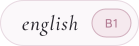</picture>
<picture><source media="(prefers-color-scheme: dark)" srcset="https://raw.githubusercontent.com/samnesvoj/samnesvoj/main/assets/dark/lang-2.svg"></picture>

<picture><source media="(prefers-color-scheme: dark)" srcset="https://raw.githubusercontent.com/samnesvoj/samnesvoj/main/assets/dark/h-hardware.svg"></picture>

I work on macOS, Windows and Linux, using several devices and my own home infrastructure for development and experiments.

<picture><source media="(prefers-color-scheme: dark)" srcset="https://raw.githubusercontent.com/samnesvoj/samnesvoj/main/assets/dark/hardware.svg">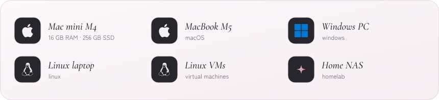</picture>

<picture><source media="(prefers-color-scheme: dark)" srcset="https://raw.githubusercontent.com/samnesvoj/samnesvoj/main/assets/dark/h-projects.svg"></picture>

<a href="https://sonya.group/"><picture><source media="(prefers-color-scheme: dark)" srcset="https://raw.githubusercontent.com/samnesvoj/samnesvoj/main/assets/dark/featured-sonya.svg"></picture></a>

<a href="https://py-lens.vercel.app"><picture><source media="(prefers-color-scheme: dark)" srcset="https://raw.githubusercontent.com/samnesvoj/samnesvoj/main/assets/dark/card-pylens.svg">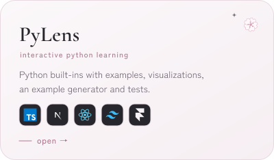</picture></a>
<a href="https://github.com/samnesvoj/sonya-group-bot"><picture><source media="(prefers-color-scheme: dark)" srcset="https://raw.githubusercontent.com/samnesvoj/samnesvoj/main/assets/dark/card-group-bot.svg">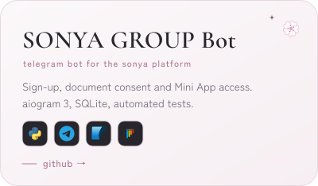</picture></a>

<picture><source media="(prefers-color-scheme: dark)" srcset="https://raw.githubusercontent.com/samnesvoj/samnesvoj/main/assets/dark/card-automation.svg">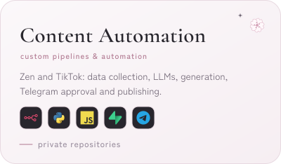</picture>
<a href="https://xn--90arbb4bc.xn--80akiboadj.xn--p1ai/"><picture><source media="(prefers-color-scheme: dark)" srcset="https://raw.githubusercontent.com/samnesvoj/samnesvoj/main/assets/dark/card-aminelli.svg">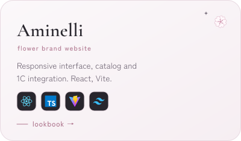</picture></a>

<a href="https://xn--80aagmpqkfnk5o.xn--80akiboadj.xn--p1ai/"><picture><source media="(prefers-color-scheme: dark)" srcset="https://raw.githubusercontent.com/samnesvoj/samnesvoj/main/assets/dark/card-taplinks.svg">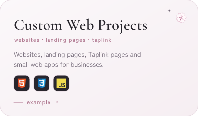</picture></a>
<picture><source media="(prefers-color-scheme: dark)" srcset="https://raw.githubusercontent.com/samnesvoj/samnesvoj/main/assets/dark/card-gforms.svg">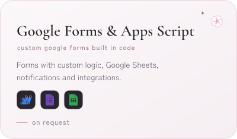</picture>

<a href="https://sonya.group/">sonya.group</a> · <a href="https://py-lens.vercel.app">open PyLens</a> · <a href="https://github.com/samnesvoj/PyLens">PyLens on GitHub</a> · <a href="https://github.com/samnesvoj/sonya-group-bot">SONYA GROUP Bot on GitHub</a> · more technical details in <a href="docs/projects.md"><code>docs/projects.md</code></a>

<picture><source media="(prefers-color-scheme: dark)" srcset="https://raw.githubusercontent.com/samnesvoj/samnesvoj/main/assets/dark/h-activity.svg"></picture>

On GitHub I publish my own projects, experiments and solutions. On Codewars I practice programming and algorithms.

<a href="https://github.com/samnesvoj"><picture><source media="(prefers-color-scheme: dark)" srcset="https://raw.githubusercontent.com/samnesvoj/samnesvoj/main/assets/dark/stats.svg"></picture></a>
<a href="https://www.codewars.com/users/ex-lain"><picture><source media="(prefers-color-scheme: dark)" srcset="https://raw.githubusercontent.com/samnesvoj/samnesvoj/main/assets/dark/codewars.svg"></picture></a>

<picture><source media="(prefers-color-scheme: dark)" srcset="https://raw.githubusercontent.com/samnesvoj/samnesvoj/main/assets/dark/activity.svg"></picture>

<picture><source media="(prefers-color-scheme: dark)" srcset="https://raw.githubusercontent.com/samnesvoj/samnesvoj/main/assets/dark/h-learning.svg"></picture>

<picture><source media="(prefers-color-scheme: dark)" srcset="https://raw.githubusercontent.com/samnesvoj/samnesvoj/main/assets/dark/learning.svg">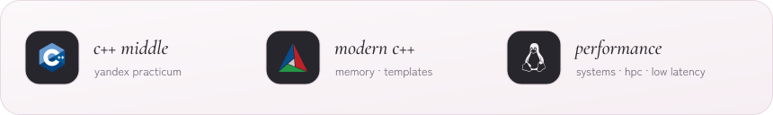</picture>

First-year Applied Informatics student at Kuban State Agrarian University (KubSAU).

I'm currently taking the C++ Middle course at Yandex Practicum, studying modern C++, memory management, templates, metaprogramming and development tools.

I'm also interested in systems programming, high-performance application architecture and low latency engineering.

<picture><source media="(prefers-color-scheme: dark)" srcset="https://raw.githubusercontent.com/samnesvoj/samnesvoj/main/assets/dark/h-find.svg"></picture>

I take orders for backend, web development, Telegram apps, AI integrations, automation, pipelines and programmatic Google Forms development.

Open to collaboration, commercial projects and job offers.

<a href="https://t.me/removed"><picture><source media="(prefers-color-scheme: dark)" srcset="https://raw.githubusercontent.com/samnesvoj/samnesvoj/main/assets/dark/pill-telegram.svg"></picture></a>
<a href="https://github.com/samnesvoj"><picture><source media="(prefers-color-scheme: dark)" srcset="https://raw.githubusercontent.com/samnesvoj/samnesvoj/main/assets/dark/pill-github.svg"></picture></a>
<a href="https://www.codewars.com/users/ex-lain"><picture><source media="(prefers-color-scheme: dark)" srcset="https://raw.githubusercontent.com/samnesvoj/samnesvoj/main/assets/dark/pill-codewars.svg"></picture></a>
<a href="mailto:removed"><picture><source media="(prefers-color-scheme: dark)" srcset="https://raw.githubusercontent.com/samnesvoj/samnesvoj/main/assets/dark/pill-email.svg"></picture></a>

<picture><source media="(prefers-color-scheme: dark)" srcset="https://raw.githubusercontent.com/samnesvoj/samnesvoj/main/assets/dark/footer.svg"></picture>

Hand-made SVGs generated by <a href="scripts/build_assets.py">scripts/build_assets.py</a>, with stats refreshed daily. Motion-free versions are in <a href="assets/static">assets/static</a>.

