<picture><source media="(prefers-color-scheme: dark)" srcset="https://raw.githubusercontent.com/samnesvoj/samnesvoj/main/assets/dark/cover.svg"></picture>

<picture><source media="(prefers-color-scheme: dark)" srcset="https://raw.githubusercontent.com/samnesvoj/samnesvoj/main/assets/dark/lang-en-active.svg"></picture>&nbsp;<a href="README.ru.md"><picture><source media="(prefers-color-scheme: dark)" srcset="https://raw.githubusercontent.com/samnesvoj/samnesvoj/main/assets/dark/lang-ru.svg"></picture></a>

<picture><source media="(prefers-color-scheme: dark)" srcset="https://raw.githubusercontent.com/samnesvoj/samnesvoj/main/assets/dark/h-about.svg"></picture>
<picture><source media="(prefers-color-scheme: dark)" srcset="https://raw.githubusercontent.com/samnesvoj/samnesvoj/main/assets/dark/about.svg"></picture>

<a href="docs/about.md">The longer version</a> · <a href="docs/projects.md">project notes</a>

<picture><source media="(prefers-color-scheme: dark)" srcset="https://raw.githubusercontent.com/samnesvoj/samnesvoj/main/assets/dark/h-work.svg"></picture>
<a href="https://sonya.group/"><picture><source media="(prefers-color-scheme: dark)" srcset="https://raw.githubusercontent.com/samnesvoj/samnesvoj/main/assets/dark/work-sonya.svg"></picture></a>
<a href="https://py-lens.vercel.app"><picture><source media="(prefers-color-scheme: dark)" srcset="https://raw.githubusercontent.com/samnesvoj/samnesvoj/main/assets/dark/work-pylens.svg">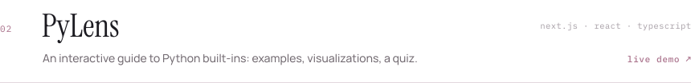</picture></a>
<picture><source media="(prefers-color-scheme: dark)" srcset="https://raw.githubusercontent.com/samnesvoj/samnesvoj/main/assets/dark/work-group-bot.svg">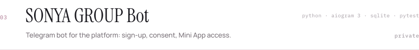</picture>
<picture><source media="(prefers-color-scheme: dark)" srcset="https://raw.githubusercontent.com/samnesvoj/samnesvoj/main/assets/dark/work-automation.svg">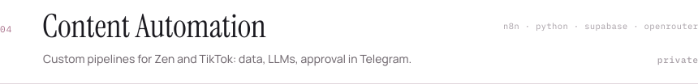</picture>
<a href="https://xn--90arbb4bc.xn--80akiboadj.xn--p1ai/"><picture><source media="(prefers-color-scheme: dark)" srcset="https://raw.githubusercontent.com/samnesvoj/samnesvoj/main/assets/dark/work-aminelli.svg">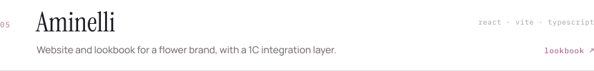</picture></a>
<a href="https://xn--80aagmpqkfnk5o.xn--80akiboadj.xn--p1ai/"><picture><source media="(prefers-color-scheme: dark)" srcset="https://raw.githubusercontent.com/samnesvoj/samnesvoj/main/assets/dark/work-web.svg">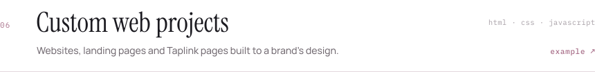</picture></a>
<picture><source media="(prefers-color-scheme: dark)" srcset="https://raw.githubusercontent.com/samnesvoj/samnesvoj/main/assets/dark/work-gforms.svg">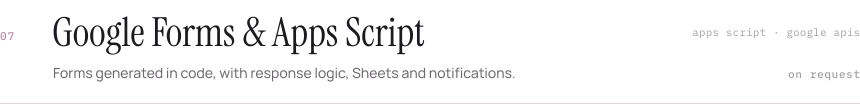</picture>

<a href="https://github.com/samnesvoj/PyLens">PyLens source</a> · Open source: <a href="https://github.com/samnesvoj/readme-inspector">readme-inspector</a>, <a href="https://github.com/samnesvoj/json-flow">json-flow</a>, <a href="https://github.com/samnesvoj/cpp-bench-lab">cpp-bench-lab</a>

<picture><source media="(prefers-color-scheme: dark)" srcset="https://raw.githubusercontent.com/samnesvoj/samnesvoj/main/assets/dark/h-stack.svg"></picture>
<picture><source media="(prefers-color-scheme: dark)" srcset="https://raw.githubusercontent.com/samnesvoj/samnesvoj/main/assets/dark/stack-card.svg"></picture>

Open the stack — every logo links to its documentation

 

<picture><source media="(prefers-color-scheme: dark)" srcset="https://raw.githubusercontent.com/samnesvoj/samnesvoj/main/assets/dark/g-languages.svg"></picture>

<picture><source media="(prefers-color-scheme: dark)" srcset="https://raw.githubusercontent.com/samnesvoj/samnesvoj/main/assets/dark/g-web.svg"></picture>

<picture><source media="(prefers-color-scheme: dark)" srcset="https://raw.githubusercontent.com/samnesvoj/samnesvoj/main/assets/dark/g-ai.svg"></picture>

<picture><source media="(prefers-color-scheme: dark)" srcset="https://raw.githubusercontent.com/samnesvoj/samnesvoj/main/assets/dark/g-automation.svg"></picture>

<picture><source media="(prefers-color-scheme: dark)" srcset="https://raw.githubusercontent.com/samnesvoj/samnesvoj/main/assets/dark/g-infra.svg"></picture>

<picture><source media="(prefers-color-scheme: dark)" srcset="https://raw.githubusercontent.com/samnesvoj/samnesvoj/main/assets/dark/g-platforms.svg"></picture>

<picture><source media="(prefers-color-scheme: dark)" srcset="https://raw.githubusercontent.com/samnesvoj/samnesvoj/main/assets/dark/h-services.svg"></picture>
<picture><source media="(prefers-color-scheme: dark)" srcset="https://raw.githubusercontent.com/samnesvoj/samnesvoj/main/assets/dark/services.svg">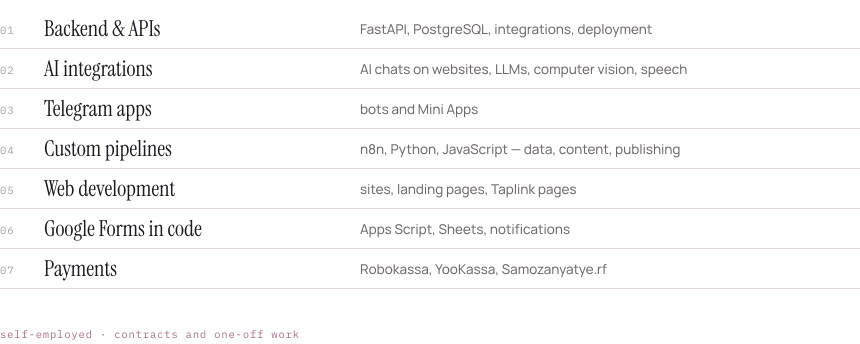</picture>

Write on Telegram <a href="https://t.me/removed">@removed</a> or by email.

<picture><source media="(prefers-color-scheme: dark)" srcset="https://raw.githubusercontent.com/samnesvoj/samnesvoj/main/assets/dark/h-studio.svg"></picture>
<picture><source media="(prefers-color-scheme: dark)" srcset="https://raw.githubusercontent.com/samnesvoj/samnesvoj/main/assets/dark/studio.svg">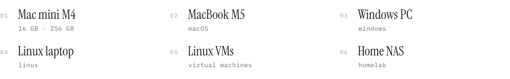</picture>

<picture><source media="(prefers-color-scheme: dark)" srcset="https://raw.githubusercontent.com/samnesvoj/samnesvoj/main/assets/dark/h-background.svg"></picture>
<picture><source media="(prefers-color-scheme: dark)" srcset="https://raw.githubusercontent.com/samnesvoj/samnesvoj/main/assets/dark/background.svg">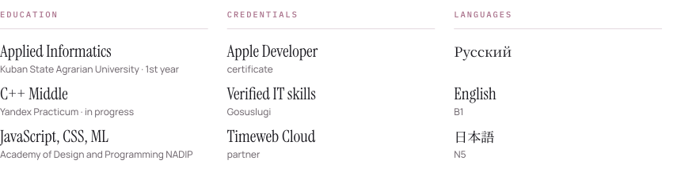</picture>

<picture><source media="(prefers-color-scheme: dark)" srcset="https://raw.githubusercontent.com/samnesvoj/samnesvoj/main/assets/dark/h-activity.svg"></picture>

<a href="https://github.com/samnesvoj"><picture><source media="(prefers-color-scheme: dark)" srcset="https://raw.githubusercontent.com/samnesvoj/samnesvoj/main/assets/dark/stats.svg">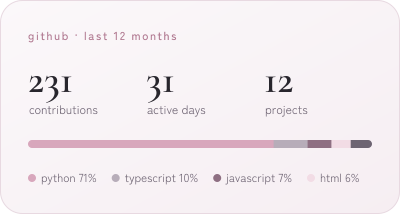</picture></a>
<a href="https://www.codewars.com/users/ex-lain"><picture><source media="(prefers-color-scheme: dark)" srcset="https://raw.githubusercontent.com/samnesvoj/samnesvoj/main/assets/dark/codewars.svg">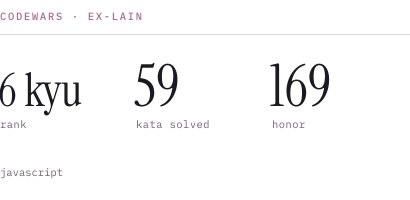</picture></a>

<picture><source media="(prefers-color-scheme: dark)" srcset="https://raw.githubusercontent.com/samnesvoj/samnesvoj/main/assets/dark/activity.svg">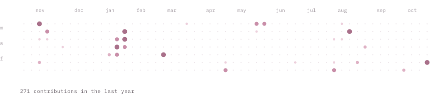</picture>

Projects, experiments and solutions on GitHub; programming practice on <a href="https://www.codewars.com/users/ex-lain">Codewars</a>.

<picture><source media="(prefers-color-scheme: dark)" srcset="https://raw.githubusercontent.com/samnesvoj/samnesvoj/main/assets/dark/h-contact.svg"></picture>

<a href="https://t.me/removed"><picture><source media="(prefers-color-scheme: dark)" srcset="https://raw.githubusercontent.com/samnesvoj/samnesvoj/main/assets/dark/contact-telegram.svg"></picture></a>&nbsp;&nbsp;&nbsp;
<a href="mailto:removed"><picture><source media="(prefers-color-scheme: dark)" srcset="https://raw.githubusercontent.com/samnesvoj/samnesvoj/main/assets/dark/contact-email.svg"></picture></a>&nbsp;&nbsp;&nbsp;
<a href="https://github.com/samnesvoj"><picture><source media="(prefers-color-scheme: dark)" srcset="https://raw.githubusercontent.com/samnesvoj/samnesvoj/main/assets/dark/contact-github.svg"></picture></a>&nbsp;&nbsp;&nbsp;
<a href="https://www.codewars.com/users/ex-lain"><picture><source media="(prefers-color-scheme: dark)" srcset="https://raw.githubusercontent.com/samnesvoj/samnesvoj/main/assets/dark/contact-codewars.svg"></picture></a>&nbsp;&nbsp;&nbsp;

<picture><source media="(prefers-color-scheme: dark)" srcset="https://raw.githubusercontent.com/samnesvoj/samnesvoj/main/assets/dark/colophon.svg"></picture>
