<picture><source media="(prefers-color-scheme: dark)" srcset="https://raw.githubusercontent.com/samnesvoj/samnesvoj/main/assets/ru/dark/cover.svg"></picture>

<a href="README.md"><picture><source media="(prefers-color-scheme: dark)" srcset="https://raw.githubusercontent.com/samnesvoj/samnesvoj/main/assets/dark/lang-en.svg"></picture></a>&nbsp;<picture><source media="(prefers-color-scheme: dark)" srcset="https://raw.githubusercontent.com/samnesvoj/samnesvoj/main/assets/dark/lang-ru-active.svg"></picture>

<picture><source media="(prefers-color-scheme: dark)" srcset="https://raw.githubusercontent.com/samnesvoj/samnesvoj/main/assets/ru/dark/h-about.svg"></picture>
<picture><source media="(prefers-color-scheme: dark)" srcset="https://raw.githubusercontent.com/samnesvoj/samnesvoj/main/assets/ru/dark/about.svg"></picture>

<a href="docs/about.ru.md">Подробнее обо мне</a> · <a href="docs/projects.md">заметки о проектах</a>

<picture><source media="(prefers-color-scheme: dark)" srcset="https://raw.githubusercontent.com/samnesvoj/samnesvoj/main/assets/ru/dark/h-work.svg"></picture>
<a href="https://sonya.group/"><picture><source media="(prefers-color-scheme: dark)" srcset="https://raw.githubusercontent.com/samnesvoj/samnesvoj/main/assets/ru/dark/work-sonya.svg"></picture></a>
<a href="https://py-lens.vercel.app"><picture><source media="(prefers-color-scheme: dark)" srcset="https://raw.githubusercontent.com/samnesvoj/samnesvoj/main/assets/ru/dark/work-pylens.svg">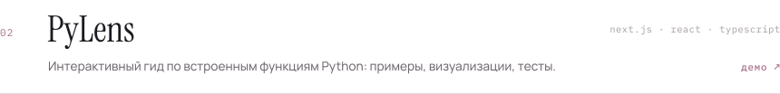</picture></a>
<picture><source media="(prefers-color-scheme: dark)" srcset="https://raw.githubusercontent.com/samnesvoj/samnesvoj/main/assets/ru/dark/work-group-bot.svg">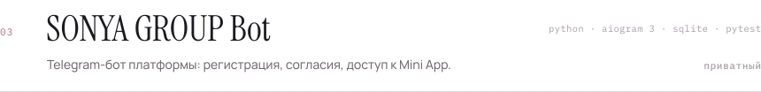</picture>
<picture><source media="(prefers-color-scheme: dark)" srcset="https://raw.githubusercontent.com/samnesvoj/samnesvoj/main/assets/ru/dark/work-automation.svg">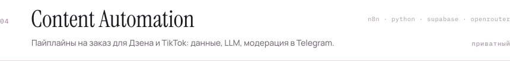</picture>
<a href="https://xn--90arbb4bc.xn--80akiboadj.xn--p1ai/"><picture><source media="(prefers-color-scheme: dark)" srcset="https://raw.githubusercontent.com/samnesvoj/samnesvoj/main/assets/ru/dark/work-aminelli.svg">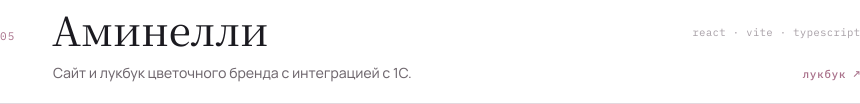</picture></a>
<a href="https://xn--80aagmpqkfnk5o.xn--80akiboadj.xn--p1ai/"><picture><source media="(prefers-color-scheme: dark)" srcset="https://raw.githubusercontent.com/samnesvoj/samnesvoj/main/assets/ru/dark/work-web.svg">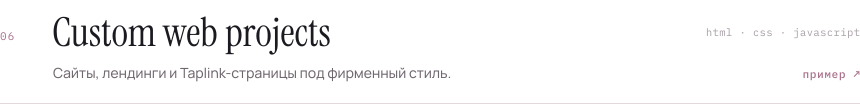</picture></a>
<picture><source media="(prefers-color-scheme: dark)" srcset="https://raw.githubusercontent.com/samnesvoj/samnesvoj/main/assets/ru/dark/work-gforms.svg">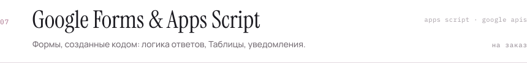</picture>

<a href="https://github.com/samnesvoj/PyLens">Код PyLens</a> · Open source: <a href="https://github.com/samnesvoj/readme-inspector">readme-inspector</a>, <a href="https://github.com/samnesvoj/json-flow">json-flow</a>, <a href="https://github.com/samnesvoj/cpp-bench-lab">cpp-bench-lab</a>

<picture><source media="(prefers-color-scheme: dark)" srcset="https://raw.githubusercontent.com/samnesvoj/samnesvoj/main/assets/ru/dark/h-stack.svg"></picture>
<picture><source media="(prefers-color-scheme: dark)" srcset="https://raw.githubusercontent.com/samnesvoj/samnesvoj/main/assets/ru/dark/stack-card.svg"></picture>

Раскрыть стек — каждый логотип ведёт на документацию

 

<picture><source media="(prefers-color-scheme: dark)" srcset="https://raw.githubusercontent.com/samnesvoj/samnesvoj/main/assets/ru/dark/g-languages.svg"></picture>

<a href="https://www.swift.org/documentation/">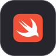</a>

<picture><source media="(prefers-color-scheme: dark)" srcset="https://raw.githubusercontent.com/samnesvoj/samnesvoj/main/assets/ru/dark/g-web.svg"></picture>

<a href="https://nextjs.org/docs">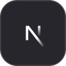</a>
<a href="https://nodejs.org/docs/latest/api/">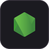</a>

<a href="https://threejs.org/docs/">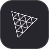</a>

<picture><source media="(prefers-color-scheme: dark)" srcset="https://raw.githubusercontent.com/samnesvoj/samnesvoj/main/assets/ru/dark/g-ai.svg"></picture>

<picture><source media="(prefers-color-scheme: dark)" srcset="https://raw.githubusercontent.com/samnesvoj/samnesvoj/main/assets/ru/dark/g-automation.svg"></picture>

<picture><source media="(prefers-color-scheme: dark)" srcset="https://raw.githubusercontent.com/samnesvoj/samnesvoj/main/assets/ru/dark/g-infra.svg"></picture>

<picture><source media="(prefers-color-scheme: dark)" srcset="https://raw.githubusercontent.com/samnesvoj/samnesvoj/main/assets/ru/dark/g-platforms.svg"></picture>

<picture><source media="(prefers-color-scheme: dark)" srcset="https://raw.githubusercontent.com/samnesvoj/samnesvoj/main/assets/ru/dark/h-services.svg"></picture>
<picture><source media="(prefers-color-scheme: dark)" srcset="https://raw.githubusercontent.com/samnesvoj/samnesvoj/main/assets/ru/dark/services.svg">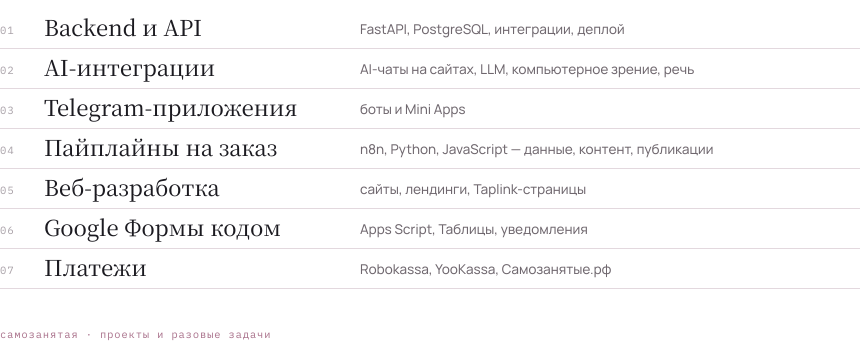</picture>

Связаться можно через <a href="https://github.com/samnesvoj">GitHub</a>.

<picture><source media="(prefers-color-scheme: dark)" srcset="https://raw.githubusercontent.com/samnesvoj/samnesvoj/main/assets/ru/dark/h-studio.svg"></picture>
<picture><source media="(prefers-color-scheme: dark)" srcset="https://raw.githubusercontent.com/samnesvoj/samnesvoj/main/assets/ru/dark/studio.svg">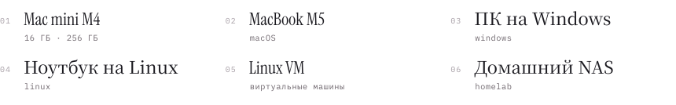</picture>

<picture><source media="(prefers-color-scheme: dark)" srcset="https://raw.githubusercontent.com/samnesvoj/samnesvoj/main/assets/ru/dark/h-background.svg"></picture>
<picture><source media="(prefers-color-scheme: dark)" srcset="https://raw.githubusercontent.com/samnesvoj/samnesvoj/main/assets/ru/dark/background.svg">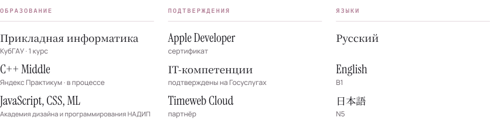</picture>

<picture><source media="(prefers-color-scheme: dark)" srcset="https://raw.githubusercontent.com/samnesvoj/samnesvoj/main/assets/ru/dark/h-activity.svg"></picture>

<a href="https://github.com/samnesvoj"><picture><source media="(prefers-color-scheme: dark)" srcset="https://raw.githubusercontent.com/samnesvoj/samnesvoj/main/assets/ru/dark/stats.svg">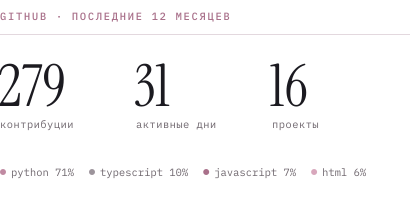</picture></a>
<a href="https://www.codewars.com/users/ex-lain"><picture><source media="(prefers-color-scheme: dark)" srcset="https://raw.githubusercontent.com/samnesvoj/samnesvoj/main/assets/ru/dark/codewars.svg">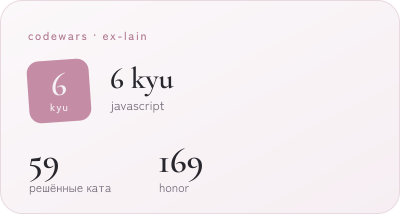</picture></a>

<picture><source media="(prefers-color-scheme: dark)" srcset="https://raw.githubusercontent.com/samnesvoj/samnesvoj/main/assets/ru/dark/activity.svg">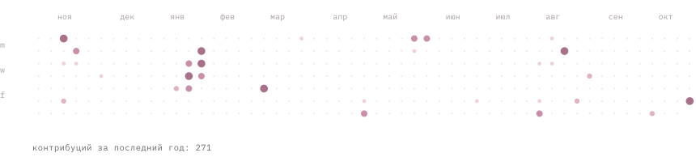</picture>

На GitHub — проекты, эксперименты и решения задач; на <a href="https://www.codewars.com/users/ex-lain">Codewars</a> практикую алгоритмы.

<picture><source media="(prefers-color-scheme: dark)" srcset="https://raw.githubusercontent.com/samnesvoj/samnesvoj/main/assets/ru/dark/h-contact.svg"></picture>

<a href="https://github.com/samnesvoj"><picture><source media="(prefers-color-scheme: dark)" srcset="https://raw.githubusercontent.com/samnesvoj/samnesvoj/main/assets/dark/contact-github.svg">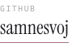</picture></a>&nbsp;&nbsp;&nbsp;
<a href="https://www.codewars.com/users/ex-lain"><picture><source media="(prefers-color-scheme: dark)" srcset="https://raw.githubusercontent.com/samnesvoj/samnesvoj/main/assets/dark/contact-codewars.svg">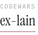</picture></a>&nbsp;&nbsp;&nbsp;

<picture><source media="(prefers-color-scheme: dark)" srcset="https://raw.githubusercontent.com/samnesvoj/samnesvoj/main/assets/ru/dark/colophon.svg"></picture>
