<picture><source media="(prefers-color-scheme: dark)" srcset="https://raw.githubusercontent.com/samnesvoj/samnesvoj/main/assets/ru/dark/hero.svg"></picture>

<a href="README.md">English</a> · <b>Русский</b>

<picture><source media="(prefers-color-scheme: dark)" srcset="https://raw.githubusercontent.com/samnesvoj/samnesvoj/main/assets/ru/dark/h-about.svg"></picture>

Привет, я Соня. Занимаюсь разработкой программного обеспечения, backend, веб-приложениями, искусственным интеллектом и автоматизацией.

Работаю над проектами целиком. Проектирую API, пишу серверную часть, работаю с базами данных, разрабатываю интерфейсы, подключаю сторонние сервисы и занимаюсь развёртыванием.

Мой основной проект **SONYA**. Это собственная платформа для автоматической обработки видео с использованием компьютерного зрения, распознавания речи, LLM и GPU-вычислений. Помимо неё, разрабатываю Telegram-приложения, сайты, инструменты автоматизации и приложения для разных платформ.

Отдельное направление моей работы связано с разработкой пайплайнов на заказ. Создаю автоматизированные процессы для обработки данных, генерации контента, публикаций, интеграции API и взаимодействия между различными сервисами. Использую Python, n8n, JavaScript и другие инструменты в зависимости от задачи.

Также разрабатываю Google Формы программно через Google Apps Script. Могу автоматизировать их создание, настроить обработку ответов, подключение Google Таблиц и выполнение различных действий после отправки формы.

Работаю с Yandex Cloud и Timeweb Cloud, являюсь партнёром Timeweb Cloud. Есть опыт интеграции Robokassa, YooKassa и Самозанятые.рф.

Сейчас углубляюсь в современный C++, системное программирование и вопросы производительности. Интересуюсь HPC, low latency и устройством высокопроизводительных систем.

Работаю как самозанятая. Принимаю заказы на разработку и рассматриваю предложения о сотрудничестве.

<picture><source media="(prefers-color-scheme: dark)" srcset="https://raw.githubusercontent.com/samnesvoj/samnesvoj/main/assets/ru/dark/g-background.svg"></picture>

<picture><source media="(prefers-color-scheme: dark)" srcset="https://raw.githubusercontent.com/samnesvoj/samnesvoj/main/assets/ru/dark/badge-university.svg"></picture>
<picture><source media="(prefers-color-scheme: dark)" srcset="https://raw.githubusercontent.com/samnesvoj/samnesvoj/main/assets/ru/dark/badge-timeweb.svg"></picture>
<picture><source media="(prefers-color-scheme: dark)" srcset="https://raw.githubusercontent.com/samnesvoj/samnesvoj/main/assets/ru/dark/badge-apple.svg"></picture>
<picture><source media="(prefers-color-scheme: dark)" srcset="https://raw.githubusercontent.com/samnesvoj/samnesvoj/main/assets/ru/dark/badge-gosuslugi.svg"></picture>
<picture><source media="(prefers-color-scheme: dark)" srcset="https://raw.githubusercontent.com/samnesvoj/samnesvoj/main/assets/ru/dark/badge-education.svg"></picture>

<picture><source media="(prefers-color-scheme: dark)" srcset="https://raw.githubusercontent.com/samnesvoj/samnesvoj/main/assets/ru/dark/h-stack.svg"></picture>

<picture><source media="(prefers-color-scheme: dark)" srcset="https://raw.githubusercontent.com/samnesvoj/samnesvoj/main/assets/ru/dark/g-languages.svg"></picture>

 
ещё · sql

<picture><source media="(prefers-color-scheme: dark)" srcset="https://raw.githubusercontent.com/samnesvoj/samnesvoj/main/assets/ru/dark/g-web.svg"></picture>

 
ещё · rest api · webhooks · apscheduler · payment integrations

<picture><source media="(prefers-color-scheme: dark)" srcset="https://raw.githubusercontent.com/samnesvoj/samnesvoj/main/assets/ru/dark/g-ai.svg"></picture>

 
ещё · yolo11 · faster-whisper · pyscenedetect · yt-dlp · openrouter

<picture><source media="(prefers-color-scheme: dark)" srcset="https://raw.githubusercontent.com/samnesvoj/samnesvoj/main/assets/ru/dark/g-automation.svg"></picture>

 
ещё · aiogram · telegraf · telegram mini apps · apify

<picture><source media="(prefers-color-scheme: dark)" srcset="https://raw.githubusercontent.com/samnesvoj/samnesvoj/main/assets/ru/dark/g-infra.svg"></picture>

 
ещё · timeweb cloud · vast.ai · systemd · ghcr

<picture><source media="(prefers-color-scheme: dark)" srcset="https://raw.githubusercontent.com/samnesvoj/samnesvoj/main/assets/ru/dark/g-platforms.svg"></picture>

<picture><source media="(prefers-color-scheme: dark)" srcset="https://raw.githubusercontent.com/samnesvoj/samnesvoj/main/assets/ru/dark/g-spoken.svg"></picture>

<picture><source media="(prefers-color-scheme: dark)" srcset="https://raw.githubusercontent.com/samnesvoj/samnesvoj/main/assets/ru/dark/lang-0.svg">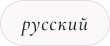</picture>
<picture><source media="(prefers-color-scheme: dark)" srcset="https://raw.githubusercontent.com/samnesvoj/samnesvoj/main/assets/ru/dark/lang-1.svg"></picture>
<picture><source media="(prefers-color-scheme: dark)" srcset="https://raw.githubusercontent.com/samnesvoj/samnesvoj/main/assets/ru/dark/lang-2.svg"></picture>

<picture><source media="(prefers-color-scheme: dark)" srcset="https://raw.githubusercontent.com/samnesvoj/samnesvoj/main/assets/ru/dark/h-hardware.svg"></picture>

Работаю на macOS, Windows и Linux. Использую несколько устройств и собственную домашнюю инфраструктуру для разработки и экспериментов.

<picture><source media="(prefers-color-scheme: dark)" srcset="https://raw.githubusercontent.com/samnesvoj/samnesvoj/main/assets/ru/dark/hardware.svg">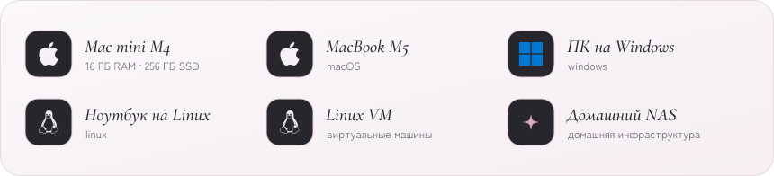</picture>

<picture><source media="(prefers-color-scheme: dark)" srcset="https://raw.githubusercontent.com/samnesvoj/samnesvoj/main/assets/ru/dark/h-projects.svg"></picture>

<a href="https://sonya.group/"><picture><source media="(prefers-color-scheme: dark)" srcset="https://raw.githubusercontent.com/samnesvoj/samnesvoj/main/assets/ru/dark/featured-sonya.svg"></picture></a>

<a href="https://py-lens.vercel.app"><picture><source media="(prefers-color-scheme: dark)" srcset="https://raw.githubusercontent.com/samnesvoj/samnesvoj/main/assets/ru/dark/card-pylens.svg">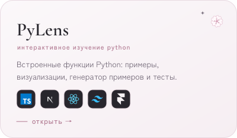</picture></a>
<a href="https://github.com/samnesvoj/sonya-group-bot"><picture><source media="(prefers-color-scheme: dark)" srcset="https://raw.githubusercontent.com/samnesvoj/samnesvoj/main/assets/ru/dark/card-group-bot.svg">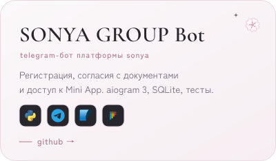</picture></a>

<picture><source media="(prefers-color-scheme: dark)" srcset="https://raw.githubusercontent.com/samnesvoj/samnesvoj/main/assets/ru/dark/card-automation.svg">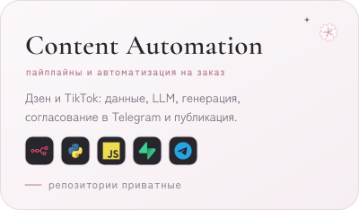</picture>
<a href="https://xn--90arbb4bc.xn--80akiboadj.xn--p1ai/"><picture><source media="(prefers-color-scheme: dark)" srcset="https://raw.githubusercontent.com/samnesvoj/samnesvoj/main/assets/ru/dark/card-aminelli.svg">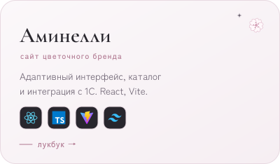</picture></a>

<a href="https://xn--80aagmpqkfnk5o.xn--80akiboadj.xn--p1ai/"><picture><source media="(prefers-color-scheme: dark)" srcset="https://raw.githubusercontent.com/samnesvoj/samnesvoj/main/assets/ru/dark/card-taplinks.svg">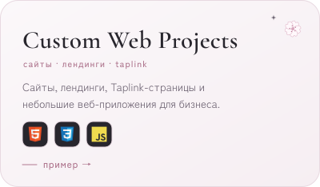</picture></a>
<picture><source media="(prefers-color-scheme: dark)" srcset="https://raw.githubusercontent.com/samnesvoj/samnesvoj/main/assets/ru/dark/card-gforms.svg">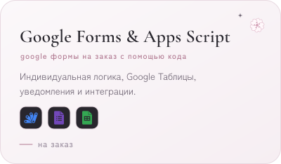</picture>

<a href="https://sonya.group/">sonya.group</a> · <a href="https://py-lens.vercel.app">Открыть PyLens</a> · <a href="https://github.com/samnesvoj/PyLens">PyLens на GitHub</a> · <a href="https://github.com/samnesvoj/sonya-group-bot">SONYA GROUP Bot на GitHub</a> · технические подробности — в <a href="docs/projects.md"><code>docs/projects.md</code></a>

<picture><source media="(prefers-color-scheme: dark)" srcset="https://raw.githubusercontent.com/samnesvoj/samnesvoj/main/assets/ru/dark/h-activity.svg"></picture>

На GitHub публикую собственные проекты, эксперименты и решения задач. На Codewars практикую программирование и алгоритмы.

<a href="https://github.com/samnesvoj"><picture><source media="(prefers-color-scheme: dark)" srcset="https://raw.githubusercontent.com/samnesvoj/samnesvoj/main/assets/ru/dark/stats.svg"></picture></a>
<a href="https://www.codewars.com/users/ex-lain"><picture><source media="(prefers-color-scheme: dark)" srcset="https://raw.githubusercontent.com/samnesvoj/samnesvoj/main/assets/ru/dark/codewars.svg"></picture></a>

<picture><source media="(prefers-color-scheme: dark)" srcset="https://raw.githubusercontent.com/samnesvoj/samnesvoj/main/assets/ru/dark/activity.svg"></picture>

<picture><source media="(prefers-color-scheme: dark)" srcset="https://raw.githubusercontent.com/samnesvoj/samnesvoj/main/assets/ru/dark/h-learning.svg"></picture>

<picture><source media="(prefers-color-scheme: dark)" srcset="https://raw.githubusercontent.com/samnesvoj/samnesvoj/main/assets/ru/dark/learning.svg">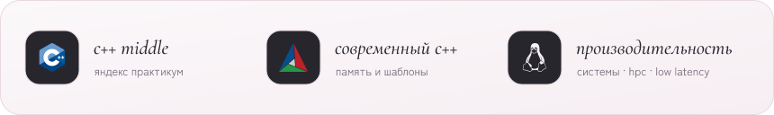</picture>

Учусь на первом курсе Кубанского государственного аграрного университета (КубГАУ) по направлению «Прикладная информатика».

Сейчас прохожу C++ Middle в Яндекс Практикуме. Изучаю современный C++, управление памятью, шаблоны, метапрограммирование и инструменты разработки.

Также интересуюсь системным программированием, архитектурой высокопроизводительных приложений и low latency engineering.

<picture><source media="(prefers-color-scheme: dark)" srcset="https://raw.githubusercontent.com/samnesvoj/samnesvoj/main/assets/ru/dark/h-find.svg"></picture>

Принимаю заказы на backend, веб-разработку, Telegram-приложения, AI-интеграции, автоматизацию, пайплайны и программную разработку Google Форм.

Открыта к сотрудничеству, коммерческим проектам и предложениям о работе.

<a href="https://t.me/removed"><picture><source media="(prefers-color-scheme: dark)" srcset="https://raw.githubusercontent.com/samnesvoj/samnesvoj/main/assets/dark/pill-telegram.svg"></picture></a>
<a href="https://github.com/samnesvoj"><picture><source media="(prefers-color-scheme: dark)" srcset="https://raw.githubusercontent.com/samnesvoj/samnesvoj/main/assets/dark/pill-github.svg"></picture></a>
<a href="https://www.codewars.com/users/ex-lain"><picture><source media="(prefers-color-scheme: dark)" srcset="https://raw.githubusercontent.com/samnesvoj/samnesvoj/main/assets/dark/pill-codewars.svg"></picture></a>
<a href="mailto:removed"><picture><source media="(prefers-color-scheme: dark)" srcset="https://raw.githubusercontent.com/samnesvoj/samnesvoj/main/assets/dark/pill-email.svg"></picture></a>

<picture><source media="(prefers-color-scheme: dark)" srcset="https://raw.githubusercontent.com/samnesvoj/samnesvoj/main/assets/ru/dark/footer.svg"></picture>

SVG нарисованы вручную и генерируются скриптом <a href="scripts/build_assets.py">scripts/build_assets.py</a>, статистика обновляется каждый день. Версии без анимаций — в <a href="assets/static">assets/static</a>.

